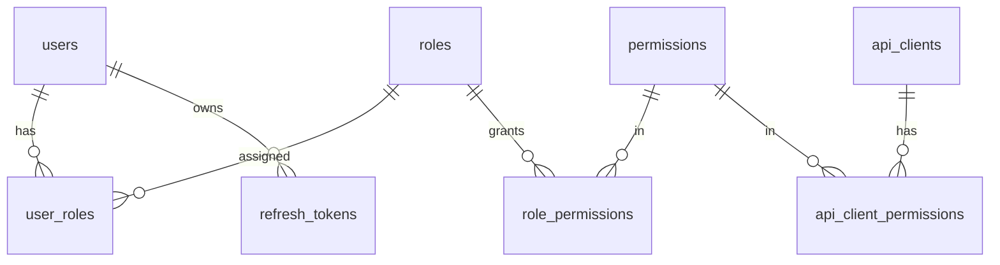

# Data Model

All tables use `AuditMixin` (`id` UUID PK, `created_by`, `created_on`, `updated_by`, `updated_on`, `is_deleted`). Those columns are not repeated below.

Unique columns on soft-deletable tables use a **partial unique index** (`WHERE is_deleted = false`), so a deleted row does not block re-use.

## ER diagram

## Tables

### `users`
| Column | Type | Notes |
|---|---|---|
| username | String(64) | separate from email; unique without regard to case among non-deleted users |
| email | String(255) | unique (lower-cased) |
| password_hash | String(255) | argon2 |
| full_name | String(255) | |
| is_active | Boolean | default true; false = cannot log in |
| failed_login_count | Integer | default 0; reset on success |
| locked_until | DateTime(tz) | NULL = not locked |
| last_login_on | DateTime(tz) | |

### `roles`
| Column | Type | Notes |
|---|---|---|
| code | String(64) | unique, e.g. `admin` |
| name | String(128) | display name |
| description | String(512) | |
| is_system | Boolean | seeded roles; cannot be deleted |

### `permissions`
| Column | Type | Notes |
|---|---|---|
| code | String(128) | unique, `resource:action` |
| description | String(512) | |

Seeded via migration (defined in code, not created from the UI).

Models live in `app/models/rbac.py` (`Role`, `Permission`, `UserRole`, `RolePermission`). `roles.code` has a partial unique index (non-deleted rows only).

### `user_roles`
| Column | Type | Notes |
|---|---|---|
| user_id | UUID FK → users.id | |
| role_id | UUID FK → roles.id | |

Unique `(user_id, role_id)`.

### `role_permissions`
| Column | Type | Notes |
|---|---|---|
| role_id | UUID FK → roles.id | |
| permission_id | UUID FK → permissions.id | |

Unique `(role_id, permission_id)`.

### `refresh_tokens`
| Column | Type | Notes |
|---|---|---|
| user_id | UUID FK → users.id | indexed |
| token_hash | String(64) | unique, SHA-256 hex of token |
| family_id | UUID | same for all rotations of one login; indexed |
| expires_on | DateTime(tz) | |
| revoked_on | DateTime(tz) | NULL = valid |
| replaced_by_id | UUID FK → refresh_tokens.id | set on rotation |

Reuse detection: a revoked token is presented again → revoke the whole `family_id`.

### `api_clients`
| Column | Type | Notes |
|---|---|---|
| client_id | String(64) | unique, public identifier |
| secret_hash | String(255) | argon2; plain secret shown once |
| name | String(128) | integration name |
| description | String(512) | optional |
| is_active | Boolean | default true |
| expires_on | DateTime(tz) | NULL = no expiry |
| allowed_ips | JSONB | list of IPs/CIDRs; NULL = any |
| last_used_on | DateTime(tz) | |

### `api_client_permissions`
| Column | Type | Notes |
|---|---|---|
| api_client_id | UUID FK → api_clients.id | |
| permission_id | UUID FK → permissions.id | |

Unique `(api_client_id, permission_id)`.

## Rules

1. Join tables (`user_roles`, `role_permissions`, `api_client_permissions`): **hard delete** on revoke.
2. Email verification / password reset: **later** (will add `is_verified` + a `user_tokens` table).
3. Expired `refresh_tokens`: purged by a scheduled cleanup job.
