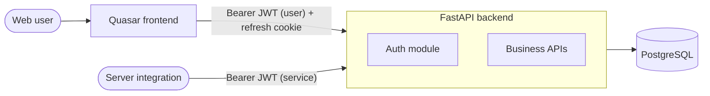
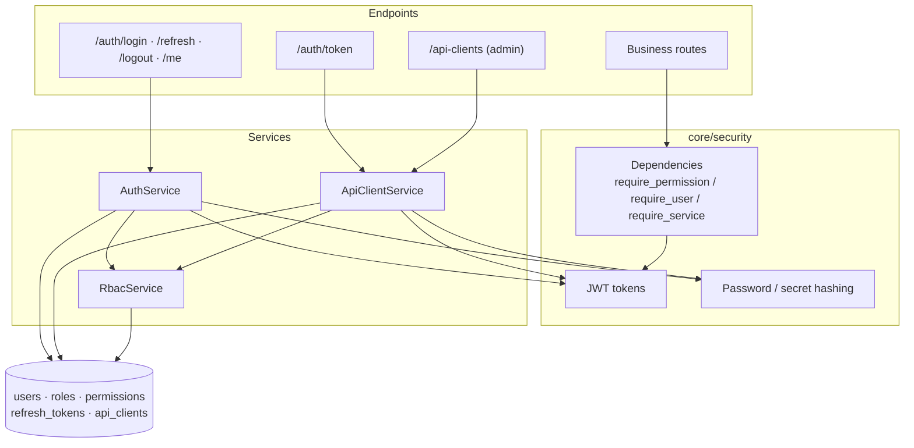
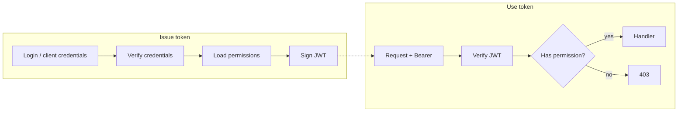

# High Level Design

## 1. Context

Two kinds of caller, one token format:

| Caller | Gets token from | Token `type` | Permissions from |
|---|---|---|---|
| Web user | `/auth/login`, `/auth/refresh` | `user` | roles |
| Server integration | `/auth/token` (client credentials) | `service` | client scopes |

## 2. Components

## 3. Main flows

- **Web user:** access token ~15 min; refresh cookie (~7 days, rotated) renews it silently.
- **Integration:** requests a new service token on expiry; no refresh token.
- **Authorization:** checked from token claims only, with no DB hit per request.

## 4. Security boundaries

| Concern | Control |
|---|---|
| Stolen access token | short TTL (15 min) |
| Stolen refresh token | HttpOnly cookie, rotation, reuse → revoke family |
| Brute-force login | lockout after N failures, rate limiting |
| Leaked client secret | stored hashed, rotate / revoke, optional IP allowlist |
| Audit | actor (`user:<id>` / `service:<client_id>`) written to `created_by` / `updated_by` and request logs |
