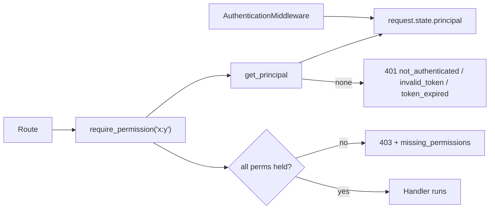
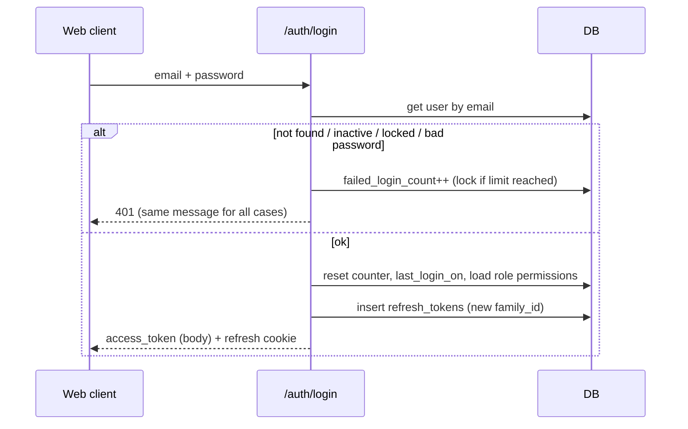
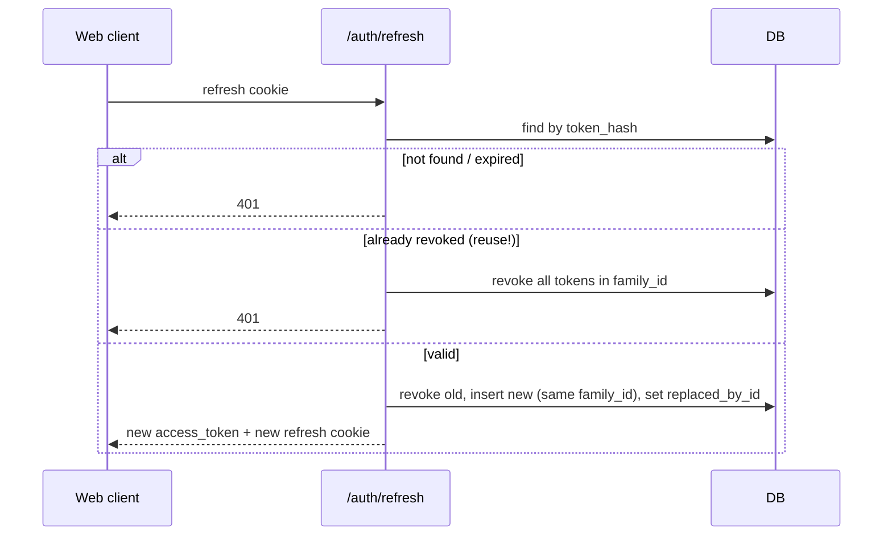
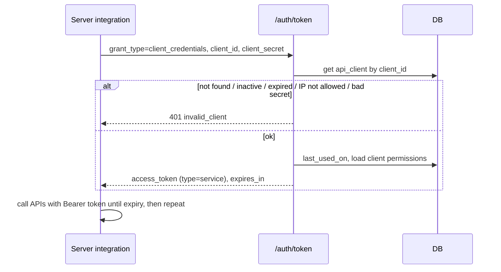

# Low Level Design

## 1. Code layout (backend/app)

Follows the project pattern: **schema → endpoint (business logic) → service (one per table, `BaseService`, `@track_service`) → model**. Errors are `AppException` subclasses; responses use the standard envelopes.

| File | Responsibility | Step |
|---|---|---|
| `core/security/passwords.py` | argon2 hash / verify (`pwdlib`), dummy verify for timing | 1 ✅ |
| `core/security/tokens.py` | create / verify JWT (`pyjwt`) → `Principal` | 1 ✅ |
| `core/security/principal.py` | `Principal` (id, type, permissions, actor) | 1 ✅ |
| `core/security/dependencies.py` | `get_principal`, `require_user`, `require_service`, `require_permission`, `CurrentUser`… | 1 ✅ |
| `middleware/authentication.py` | Bearer token → `request.state.principal` + current actor | 1 ✅ |
| `models/user.py`, `schemas/user.py`, `services/user.py` | users table | 1 ✅ |
| `schemas/auth.py` | `LoginRequest`, `TokenResponse` | 1 ✅ |
| `api/v1/endpoints/auth.py` | `/auth/register`, `/auth/login`, `/auth/me` | 1 ✅ |
| `models/refresh_token.py`, `services/refresh_token.py`, `core/security/cookies.py` + `/auth/refresh`, `/auth/logout` | refresh rotation, HttpOnly cookie | 2 ✅ |
| `core/security/permissions.py` | permission catalog (`Perm` enum), `ADMIN_ROLE` | 3 ✅ |
| `models/rbac.py`, `schemas/rbac.py` | roles, permissions, user_roles, role_permissions | 3 ✅ |
| `services/role.py`, `permission.py`, `user_role.py`, `role_permission.py` | one service per table | 3 ✅ |
| `api/v1/access.py` | resolve role/permission codes, grant rules, user detail | 3 ✅ |
| `api/v1/endpoints/users.py`, `roles.py` | `/users`, `/roles`, `/permissions` | 3 ✅ |
| `scripts/create_admin.py` | bootstrap the first admin | 3 ✅ |
| `models/api_client.py`, `schemas/api_client.py`, `services/api_client.py`, `services/api_client_permission.py`, `endpoints/api_clients.py`, `client_credentials` grant in `/auth/token` | client credentials | 4 ✅ |

Every service method is decorated with `@track_service` (inherited `BaseService` methods already are), so auth calls appear in `service_call_logs`.

## 2. Settings (`core/config.py`)

| Setting | Default |
|---|---|
| `JWT_SECRET_KEY` | required, ≥ 32 chars |
| `JWT_ALGORITHM` | `HS256` |
| `JWT_ISSUER` | `base-api` |
| `ACCESS_TOKEN_TTL_MINUTES` | 15 |
| `LOGIN_MAX_FAILED` / `LOGIN_LOCK_MINUTES` | 5 / 15 |
| `AUTH_SELF_REGISTRATION_ENABLED` | `false` |
| `REFRESH_TOKEN_TTL_DAYS` | 7 |
| `REFRESH_COOKIE_NAME` | `refresh_token` |
| `REFRESH_COOKIE_SECURE` / `REFRESH_COOKIE_SAMESITE` | `true` / `lax` |
| `SERVICE_TOKEN_TTL_MINUTES` | 15 |

Refresh cookie: HttpOnly, path `/api/v1/auth` (not sent with other API calls). The refresh token is an opaque random string; only its SHA-256 is stored.

## 3. JWT claims

| Claim | User token | Service token |
|---|---|---|
| `sub` | user id | client_id |
| `type` | `user` | `service` |
| `perms` | permission codes (from roles) | permission codes (scopes) |
| `iss`, `iat`, `exp`, `jti` | yes | yes |

Permissions are embedded in the token, so a request needs **no DB lookup**. A permission change takes effect within one token lifetime (≤15 min).

## 4. Principal (result of authentication)

```python
@dataclass(frozen=True)
class Principal:
    id: str               # user id or client_id
    type: Literal["user", "service"]
    permissions: frozenset[str]
    actor -> "user:<id>" | "service:<client_id>"
```

## 5. Middleware + dependencies

Middleware order (outer → inner): `RequestContext` → **`Authentication`** → `AccessLog` → CORS → … → endpoint.

`AuthenticationMiddleware` (no DB access):
- valid token → `request.state.principal` + `set_current_actor(principal.actor)`, so `created_by`/`updated_by`, `requests.created_by` and `service_call_logs.created_by` show the caller
- no token → anonymous (actor `system`)
- bad / expired token → anonymous + `request.state.auth_error`
- never rejects; public routes keep working

Dependencies decide access:



`get_principal` also declares two OpenAPI security schemes: `OAuth2` (password and clientCredentials flows, tokenUrl `/auth/token`) and `BearerToken`. Both use `auto_error=False` and serve only for documentation: they give Swagger its Authorize button and lock icons, and the middleware still does the real check.

Usage:
```python
@router.get("/request-logs", dependencies=[Depends(require_permission("request_logs:read"))])
```

## 6. Flows

### 6.1 Login


### 6.2 Refresh (rotation + reuse detection)


The token row is locked (`SELECT … FOR UPDATE`) during rotation, so two refreshes with one token cannot both succeed. A deleted or disabled user also revokes the family.

**Frontend rule:** run only one refresh at a time (share one in-flight promise across tabs and requests). Two parallel refreshes with the same token count as reuse and end the session.

### 6.3 Logout
`POST /auth/logout` → revoke the cookie's token family → clear cookie → 204 (always).

### 6.4 Service token (client credentials)


Implementation notes:
- `client_id` = `cli_` + random string; secret = random 32 bytes, stored as an argon2 hash.
- Credentials are accepted in the form body or as HTTP Basic.
- The IP check uses `request.client.host`. Behind a proxy, run uvicorn with `--proxy-headers --forwarded-allow-ips=<proxy>` so this is the real caller.
- Failures are logged (WARNING, `client_id` + IP) and all return the same `401 invalid_client`.

### 6.5 API client admin
| Action | Effect |
|---|---|
| Create | generate `client_id` + secret, store argon2 hash, return secret **once** |
| Rotate secret | new secret, old one invalid immediately |
| Revoke | `is_active = false` or delete (tokens already issued expire within 15 min) |
| Grant | only permissions the admin holds (same grant rule as roles) |

## 7. Errors

| Case | Status | `error.code` |
|---|---|---|
| No token | 401 + `WWW-Authenticate: Bearer` | `not_authenticated` |
| Bad token / expired token | 401 | `invalid_token` / `token_expired` |
| Wrong login (any reason) | 401 | `invalid_credentials` |
| Missing / unknown / expired / reused refresh token | 401 | `invalid_refresh_token` |
| Wrong token type for route | 403 | `forbidden` |
| Missing permission | 403 | `forbidden` (+ `details.missing_permissions`) |

Uses the existing error envelope (`app/core/exceptions`).

## 8. RBAC rules

- **Catalog:** permissions are defined in `core/security/permissions.py` and inserted by migrations, never through the API. `tests/test_rbac.py` fails if the code and the table disagree.
- **Adding a permission:** add it to `Perm` and `DESCRIPTIONS`, then write a migration that inserts it and grants it to `admin`.
- **System role `admin`:** holds every permission. It cannot be deleted and its permissions cannot be edited.
- **Grant rule:** you can only grant permissions you hold. Assigning a role requires all of its permissions; editing a role's permissions requires every added and removed one.
- **Manage rule:** disabling, deleting or changing the roles of a user requires every permission that user holds, so a manager cannot touch an admin.
- **Self-protection:** you cannot disable, delete or change the roles of your own account.
- **Effect:** permission changes reach a user at their next token (login or refresh, ≤ 15 min). Disabling or deleting a user revokes their refresh tokens.
- **Log APIs:** protected at router level with `exception_logs:read`, `request_logs:read` and `service_call_logs:read`.
- **Bootstrap:** `python -m app.scripts.create_admin <email> [name]`.

## 9. Rate limiting (`core/rate_limit.py`)

| Endpoint | Key | Setting (default) |
|---|---|---|
| `/auth/login` + `/auth/token` password grant | IP (shared counter) | `RATE_LIMIT_LOGIN` (10/minute) |
| `/auth/register` | IP | `RATE_LIMIT_REGISTER` (5/minute) |
| `/auth/refresh` | IP | `RATE_LIMIT_REFRESH` (30/minute) |
| `/auth/token` client_credentials | IP | `RATE_LIMIT_TOKEN` (60/minute) |
| `/auth/token` client_credentials | client_id | `RATE_LIMIT_TOKEN_PER_CLIENT` (30/minute) |

- How it works: a fixed-window counter. Over the limit returns `429 rate_limited` with `Retry-After`, and the event is logged at WARNING.
- Applied as a route dependency `rate_limit(scope, rule)`, or as `limiter.check(key, rule)` inside an endpoint.
- Switched on and off with `RATE_LIMIT_ENABLED` (tests turn it off).
- **Limitation:** counters live in memory per process, so with N workers the effective limit is N×. For several workers or servers, replace `limiter` with a shared Redis backend that has the same `hit` method.
- Account brute force is also stopped by the login lockout (section 6.1).

## 10. Housekeeping

`RefreshTokenService.delete_expired(before)` hard-deletes expired tokens. No scheduler exists yet; call it from a job once one is added.
