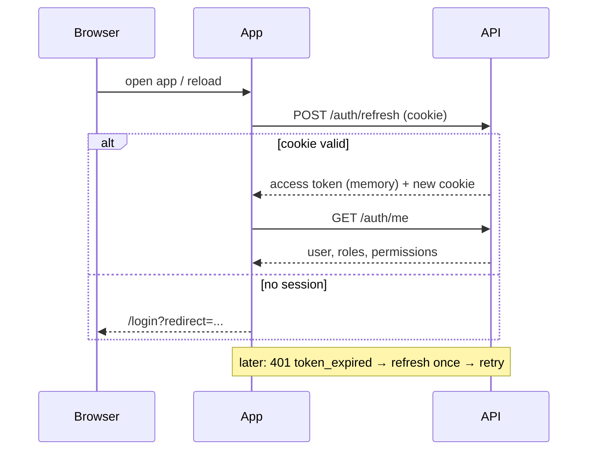

# Auth Module (`src/module/auth`)

Backend contract: [authentication_rabc_module/api.md](../authentication_rabc_module/api.md).

| File | Responsibility |
|---|---|
| `api.js` | `login`, `refresh`, `logout`, `me` |
| `store.js` | Pinia `useAuthStore`: `user`, `roles`, `permissions`, `accessToken`, `isAuthenticated`, `can()`, `canAny()`, `login()`, `refresh()`, `restoreSession()`, `logout()` |
| `install.js` | Connects the store to `api/http.js`, installs guards and `v-can` |
| `guards.js` | `router.beforeEach` access rules; `safeRedirect()` |
| `permissions.js` | `useCan()`, `v-can` directive |
| `routes.js` | `/login` (own layout, public) |
| `layouts/AuthLayout.vue`, `pages/LoginPage.vue`, `components/UserMenu.vue` | UI |

Public exports (`index.js`): `useAuthStore`, `useCan`, `vCan`, `UserMenu`.

## Session



- **Login:** `auth.login(email, password)` → token + `me` → go to `redirect`, which must be an in-app path.
- **Logout:** `POST /auth/logout`, clear the store, go to `/login`.
- **Refresh:** also reloads `me` in the background, so role changes show up within 15 minutes.
- **Login errors:** `invalid_credentials`, `rate_limited` (shows `retryAfter`), `network_error` and `timeout` each get a clear message.

## Protecting pages (route meta)

| Meta | Effect |
|---|---|
| `public: true` | No sign-in (login, 404) |
| `permission: 'users:read'` or `['a', 'b']` | Signed in + all listed permissions, else `/forbidden` |
| none | Signed in |

Parent route permissions apply to children. Signed-in users opening `/login` are sent on.

## Hiding UI

```vue
<script setup>
import { useCan } from '@/module/auth'
const { can } = useCan()
</script>
<q-btn v-if="can('users:manage')" label="Add user" />   <!-- preferred: removes it -->
<q-btn v-can="'users:manage'" label="Add user" />       <!-- directive: hides it -->
<q-btn v-can:any="['users:read', 'roles:read']" />
```

Menu entries declared by modules (`menu[].permission`) are filtered the same way.
