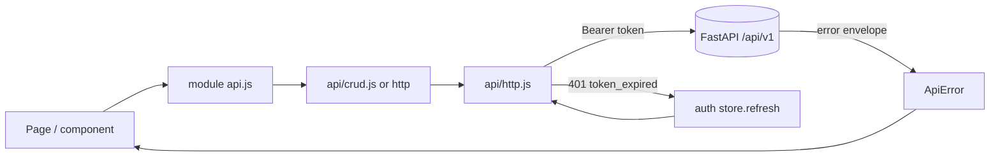

# Structure

```
frontend/src/
├── brand.js               displayed product name and logo path
├── api/                  shared backend access
│   ├── http.js           axios instance: Bearer token, refresh-once on 401, ApiError
│   ├── crud.js           createResource(path): list/search/get/create/update/remove
│   ├── errors.js         ApiError
│   └── index.js
├── components/           generic UI (App*), no business logic
├── composables/          shared logic (useNotify)
├── css/
│   ├── quasar.variables.scss   design tokens (the only place colors are defined)
│   └── app.scss                CSS custom properties + global helpers
├── layouts/MainLayout.vue      signed-in shell: header, menu (from modules), user menu
├── pages/                      shell pages: Home, Forbidden, NotFound
├── router/routes.js            shell routes + routes contributed by modules
├── boot/errors.js              global handler: unhandled errors → console + toast
├── boot/modules.js             runs each module's install(), reset() on sign-out, page title
└── module/
    ├── index.js                module registry
    └── auth/                   see auth_module.md
        ├── index.js            public exports + module definition
        ├── api.js  store.js  guards.js  permissions.js  install.js  routes.js
        ├── layouts/AuthLayout.vue
        ├── pages/LoginPage.vue
        └── components/UserMenu.vue
```

## Module contract

`src/module/<name>/index.js`:

```js
export default {
  name: 'users',
  publicRoutes: [],   // top-level routes with their own layout (e.g. /login)
  routes: [],         // children of MainLayout (signed-in area)
  menu: [{ label: 'Users', icon: 'group', to: { name: 'users' }, permission: 'users:read' }],
  install: ({ app, router, store }) => {},   // optional, runs at startup
  reset: ({ store }) => {},                  // optional, on sign-out: drop the user's data
}
```

To add a module, create the folder and add it to `modules` in `src/module/index.js`. Routes, menu entries and install hooks are picked up automatically.

Suggested layout inside a module: `api.js` (its endpoints), `store.js` (if it needs state), `routes.js`, `pages/`, `components/` (module-specific only), `__tests__/`.

A module with a store implements `reset()` (e.g. `useUsersStore(store).$reset()` or clear its refs), so the next user never sees the previous user's data.

## Request flow



## Startup

1. `boot/modules.js` calls `install()` on each module. Auth registers the token handlers, the guards and `v-can`.
2. The first navigation hits the auth guard, which calls `restoreSession()` (`POST /auth/refresh` then `GET /auth/me`).
3. The guard decides: public route, redirect to `/login?redirect=…`, `/forbidden`, or allow.
